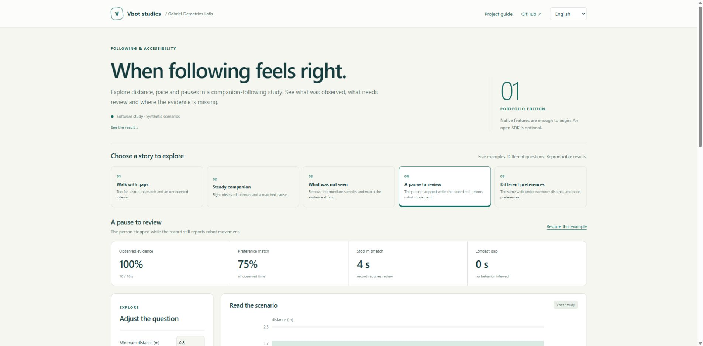
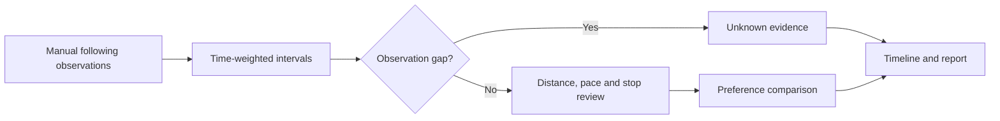

<p align="center"></p>

<h1 align="center">Companion Follow Lab</h1>

<p align="center"><strong>When following feels right.</strong><br>Acompanhar no ritmo de cada pessoa.</p>

<p align="center">
<a href="https://github.com/galafis/vbot-accessible-follow-lab/actions/workflows/checks.yml"></a>


</p>

<p align="center"><a href="https://galafis.github.io/vbot-accessible-follow-lab/?lang=en"><strong>Open the interactive study</strong></a> · <a href="https://galafis.github.io/vbot-accessible-follow-lab/?lang=pt"><strong>Abrir estudo em português</strong></a> · <a href="docs/DEMO.md">Guided walkthrough</a> · <a href="docs/EXPERIMENTS.md">Reproduce the examples</a></p>

[](https://galafis.github.io/vbot-accessible-follow-lab/?lang=en&example=stop-review)

[English](#english) · [Português](#português)

## English

Explore distance, pace and pauses in a companion-following study. See what was observed, what needs review and where the evidence is missing.

**Research question:** How much of a recorded walk matches the participant's chosen preferences?

This is a working, independent software study for a proposed Vbot companion-robotics program. You can run every example without a robot, account, package installation or API key. Physical validation has not been performed.

### Explore in one minute

1. [Open **A pause to review**](https://galafis.github.io/vbot-accessible-follow-lab/?lang=en&example=stop-review).
2. Inspect the chart and the explanation below it. The starting result is **16 s observed · 0 s unknown · 12 s matched**.
3. Adjust a control or select a contrasting example. Download a printable HTML report, a CSV evidence table or the full JSON analysis.

[View a portable example report](https://galafis.github.io/vbot-accessible-follow-lab/examples/sample-report.html).

The JSON editor is available under **Advanced**; the main study uses guided controls.

### What you can investigate

- Time-weighted distance, pace and stop observations with explicit unknown intervals.
- A distance-band chart, review timeline and observed-evidence denominator.
- Sensitivity to narrower and wider participant-selected distance bands.
- Quick controls for distance, pace and maximum observation gap.
- A 16-second steady walk, missing observations and stop-mismatch counterexamples.

All five studies include a responsive English/Portuguese interface, keyboard focus styles, synthetic narrated examples and local report exports. Analysis runs in your browser after the page loads.

### Five examples, five questions

| Example                                                                                                             | Question it exposes                                               | Reproducible core result                   |
| ------------------------------------------------------------------------------------------------------------------- | ----------------------------------------------------------------- | ------------------------------------------ |
| [Walk with gaps](https://galafis.github.io/vbot-accessible-follow-lab/?lang=en&example=baseline)                    | Too far, a stop mismatch and an unobserved interval.              | 6 s observed · 6 s unknown · 2 s matched   |
| [Steady companion](https://galafis.github.io/vbot-accessible-follow-lab/?lang=en&example=steady-follow)             | Eight observed intervals and a matched pause.                     | 16 s observed · 0 s unknown · 16 s matched |
| [What was not seen](https://galafis.github.io/vbot-accessible-follow-lab/?lang=en&example=observation-gap)          | Remove intermediate samples and watch the evidence shrink.        | 8 s observed · 8 s unknown · 8 s matched   |
| [A pause to review](https://galafis.github.io/vbot-accessible-follow-lab/?lang=en&example=stop-review)              | The person stopped while the record still reports robot movement. | 16 s observed · 0 s unknown · 12 s matched |
| [Different preferences](https://galafis.github.io/vbot-accessible-follow-lab/?lang=en&example=personal-preferences) | The same walk under narrower distance and pace preferences.       | 16 s observed · 0 s unknown · 4 s matched  |

These are deterministic scenario results, not field measurements. [Experiment notes](docs/EXPERIMENTS.md) distinguish expected regression outputs from independent arithmetic and failure-case tests.

### Run locally

Install Node.js 22 or newer. No npm dependencies are required.

```sh
git clone https://github.com/galafis/vbot-accessible-follow-lab.git
cd vbot-accessible-follow-lab
npm run serve
```

Open **http://127.0.0.1:8765**. The local server binds to your computer only. Stop with Ctrl+C. For another port, use `node server.mjs 8766`.

```sh
npm run check                                  # syntax, domain tests, examples and server checks
node cli.mjs examples/stop-review.json            # core analysis
node study.mjs examples/stop-review.json          # analysis plus derived insights
node cli.mjs examples/baseline.json new-result.json
```

The CLI refuses to overwrite an existing output file. Exit 1 means invalid input or an I/O failure; review findings are valid analytical outputs and do not change the exit code.

### How the study works



**Method:** Time-weighted interval analysis with explicit unknown gaps. The core engine and the insight layer are pure local calculations shared by browser and CLI. [Architecture](docs/ARCHITECTURE.md) · [Domain method](docs/METHOD.md) · [Input contract](docs/DATA_CONTRACT.md).

### Evidence and scope

| Evidence available now                                                         | Next evidence needed                                                  |
| ------------------------------------------------------------------------------ | --------------------------------------------------------------------- |
| 18 automated tests, five reproducible fixtures and a real interface screenshot | Measurements from a specific supplied Vbot unit                       |
| Deterministic calculations and explicit counterexamples                        | Repeated permitted exercises with operator observations               |
| Bilingual methods, reports and example inputs                                  | Appropriate authorization before institutional or participant studies |

**A standard Vbot without an open SDK is welcome.** The proposed first hardware stage uses native features, the official app and manual observations. Any later programmatic integration is optional and must be permitted by the manufacturer. [Native workflow](docs/VBOT_WORKFLOW.md) · [90-day study plan](docs/STUDY_PLAN.md).

### Project map

```text
src/        Pure domain engine, contracts and derived insights
examples/   Five narrated inputs and reproducible expected outputs
app.mjs     Guided bilingual browser workbench
styles.css  Responsive, printable visual system
cli.mjs     Core analysis from a local JSON file
study.mjs   Complete study from a local JSON file
tests/      Domain, insight, reproduction and HTTP checks
docs/       Walkthrough, experiments, method and study plan
```

## Português

Explore distância, ritmo e pausas num estudo de acompanhamento. Veja o que foi observado, o que merece revisão e onde faltam evidências.

**Pergunta do estudo:** Quanto do percurso observado corresponde às preferências escolhidas pelo participante?

O projeto está pronto para exploração em software. Os exemplos são fictícios e a validação física ainda depende de uma unidade. Uma unidade comum, sem SDK aberto, é suficiente para iniciar a fase proposta com recursos nativos e observação manual.

### Comece por um exemplo concreto

[Abra **A pausa precisa de revisão**](https://galafis.github.io/vbot-accessible-follow-lab/?lang=pt&example=stop-review). O resultado inicial é **16 s observados · 0 s desconhecidos · 12 s de preferência**. Observe o gráfico, mude um parâmetro ou escolha outro cenário. A interface explica os resultados e exporta relatório HTML imprimível, tabela CSV e análise JSON.

### Funcionalidades

- Observações ponderadas pelo tempo, com distância, ritmo, parada e lacunas explícitas.
- Gráfico da faixa de distância, linha do tempo e denominador de evidência observada.
- Comparação de faixas mais estreitas ou amplas escolhidas pelo participante.
- Controles diretos para distância, ritmo e lacuna máxima de observação.
- Exemplos de 16 segundos de acompanhamento consistente, dados ausentes e paradas desencontradas.

### Exemplos disponíveis

| Exemplo                                                                                                               | O que permite examinar                                                   | Resultado reproduzível                                    |
| --------------------------------------------------------------------------------------------------------------------- | ------------------------------------------------------------------------ | --------------------------------------------------------- |
| [Percurso com lacunas](https://galafis.github.io/vbot-accessible-follow-lab/?lang=pt&example=baseline)                | Distância excessiva, parada desencontrada e um intervalo sem observação. | 6 s observados · 6 s desconhecidos · 2 s de preferência   |
| [Ritmo consistente](https://galafis.github.io/vbot-accessible-follow-lab/?lang=pt&example=steady-follow)              | Oito intervalos observados e uma pausa acompanhada.                      | 16 s observados · 0 s desconhecidos · 16 s de preferência |
| [O que não foi visto](https://galafis.github.io/vbot-accessible-follow-lab/?lang=pt&example=observation-gap)          | Retire observações intermediárias e veja a evidência diminuir.           | 8 s observados · 8 s desconhecidos · 8 s de preferência   |
| [A pausa precisa de revisão](https://galafis.github.io/vbot-accessible-follow-lab/?lang=pt&example=stop-review)       | A pessoa parou; o registro ainda indica movimento do robô.               | 16 s observados · 0 s desconhecidos · 12 s de preferência |
| [Preferências diferentes](https://galafis.github.io/vbot-accessible-follow-lab/?lang=pt&example=personal-preferences) | O mesmo percurso sob limites mais estreitos de distância e ritmo.        | 16 s observados · 0 s desconhecidos · 4 s de preferência  |

### Executar e contribuir

Use os comandos da seção em inglês com Node.js 22 ou superior. Não é necessário instalar pacotes. `npm run check` executa verificações de sintaxe, testes e reprodução dos cenários. O guia [DEMO](docs/DEMO.md) explica um percurso de exploração; [EXPERIMENTS](docs/EXPERIMENTS.md) registra os resultados e suas limitações.

Sugestões úteis incluem novos cenários fictícios, cálculos independentes, melhorias de acessibilidade da interface e protocolos de observação autorizados. Veja [CONTRIBUTING](CONTRIBUTING.md).

## Study collection · Coleção de estudos

[01 · Companion Follow Lab](https://github.com/galafis/vbot-accessible-follow-lab) · [02 · Portuguese Interaction Bench](https://github.com/galafis/vbot-ptbr-interaction-bench) · [03 · Community Cargo Planner](https://github.com/galafis/vbot-community-cargo-planner) · [04 · Inclusive Encounter Kit](https://github.com/galafis/vbot-inclusive-encounter-kit) · [05 · Community Observation Lab](https://github.com/galafis/vbot-community-observation-lab)

---

Created by **[Gabriel Demetrios Lafis](https://www.linkedin.com/in/gabriel-demetrios-lafis/)** · [Applied AI and robotics portfolio](https://github.com/galafis#robotics)

MIT-licensed independent work. Vbot is a third-party brand; this is not an official SDK or an announced Vbot/USP partnership.
