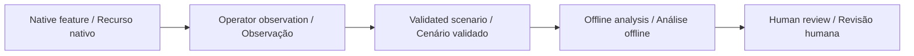

# Companion Follow Lab · Laboratório de Acompanhamento

[English](#english) · [Português](#português)

[](https://github.com/galafis/vbot-accessible-follow-lab/actions/workflows/checks.yml)

## English

Replay operator observations of Vbot native following, identify long observation gaps and compare participant-selected distance and pace preferences.

**Status: working offline software prototype, synthetic examples, no physical validation.** Built specifically to investigate Vbot companion use within the capabilities the manufacturer permits. A standard unit without an open SDK is welcome.

### Try it

Node.js 22 or later. No packages, robot, account or API key required. After cloning, computation runs offline.

```sh
git clone https://github.com/galafis/vbot-accessible-follow-lab.git
cd vbot-accessible-follow-lab
npm test
npm run demo
npm run serve
```

Open `http://127.0.0.1:8765` for the English/Portuguese workbench. Edit the synthetic scenario, run the same engine used by the CLI and export the result. The server binds only to your own computer. Ctrl+C stops it. Use one workbench at a time on port 8765.

```sh
node cli.mjs examples/baseline.json new-result.json
```

Existing output files are refused. Exit 1 means invalid input or an I/O failure; exit 0 means analysis completed, including review findings. Do not infer suitability from the exit code.

### Implemented method

Intervals use the preceding observation (zero-order hold). Intervals exceeding max_gap_s count entirely as unknown. Only fully observed intervals contribute to preference scores. The final sample has zero duration. No interpolation or clinical outcome is inferred.

### Worked example

Baseline: 12 s total, 6 s observed and 6 s unknown; 2 s match the selected preferences; 2 s show a stop mismatch. The score is 2/6 = 0.3333 over observed time, not 2/12. A 6 s gap contributes no evidence of successful following.

### Vbot relationship and limits

Uses manually entered distance, pace and stop observations. No UWB, LiDAR or camera API is assumed. Not a guide dog or mobility aid.

We can use native features, the official app and manually recorded observations. SDK access is optional; no bypass, reverse engineering or unsupported modification is planned. [Permitted workflow](docs/VBOT_WORKFLOW.md).



## Português

Reproduza observações do acompanhamento nativo do Vbot, identifique lacunas de observação e compare preferências de distância e ritmo escolhidas pelo participante.

**Estado: protótipo funcional de software offline, exemplos fictícios, sem validação física.** Focado no estudo do Vbot conforme as capacidades permitidas pelo fabricante. Uma unidade comum sem SDK aberto é suficiente para iniciar.

### Experimentar

Execute os comandos acima com Node.js 22 ou superior. Não é necessário instalar dependências. Abra a bancada local e selecione Português. Edite o cenário, recalcule e exporte o resultado. Os testes e a linha de comando usam o mesmo motor da interface.

Dados inseridos manualmente sobre distância, ritmo e parada; não exige API de sensores. É uma ferramenta de estudo, sem orientação de mobilidade para pessoas cegas.

Podemos trabalhar com funções nativas, aplicativo oficial e observações manuais. Acesso por SDK é opcional. Veja o [fluxo permitido](docs/VBOT_WORKFLOW.md) e a [validação](docs/VALIDATION.md). Os resultados demonstram comportamento do software; benefícios sociais e desempenho físico ainda precisam ser estudados.

## Documentation · Documentação

- [Input contract and method · Contrato e método](docs/METHOD.md)
- [Validation and reproducibility · Validação](docs/VALIDATION.md)
- [Vbot workflow · Fluxo Vbot](docs/VBOT_WORKFLOW.md)
- [Study plan · Plano de estudo](docs/STUDY_PLAN.md)
- [Synthetic input · Entrada fictícia](examples/baseline.json)
- [Expected output · Saída esperada](examples/expected.json)

Independent work by [Gabriel Demetrios Lafis](https://www.linkedin.com/in/gabriel-demetrios-lafis/) · [Existing robotics portfolio](https://github.com/galafis#robotics). Vbot is a third-party product/brand; this repository is not an official SDK or vendor endorsement.
